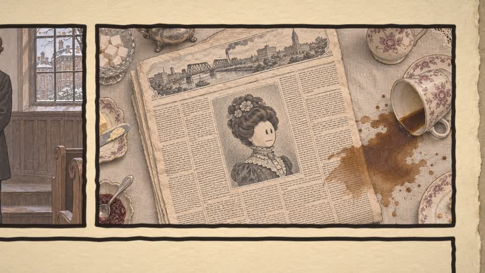
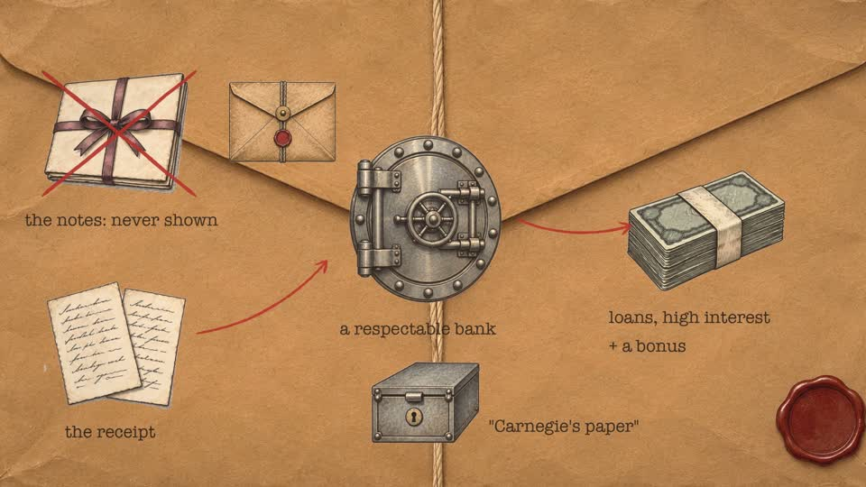
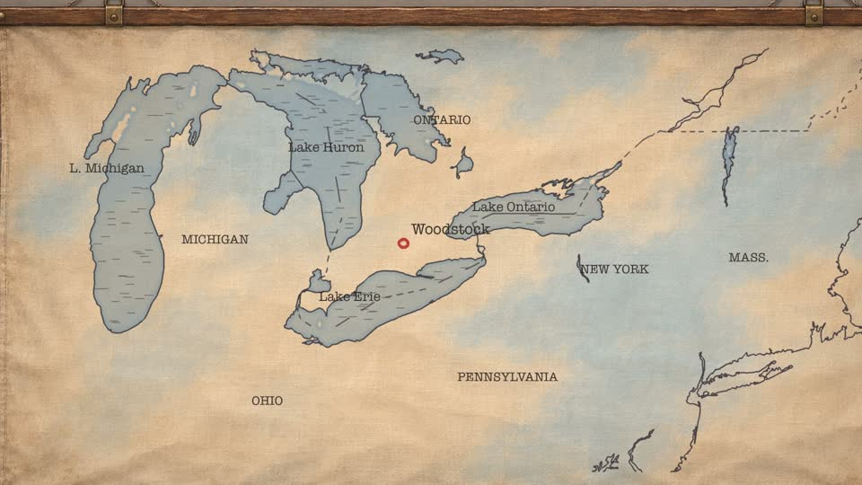
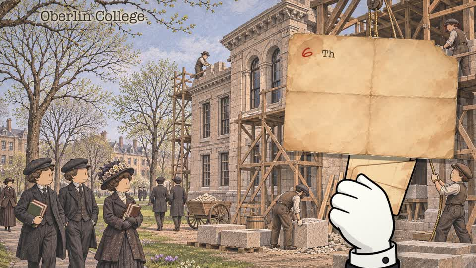
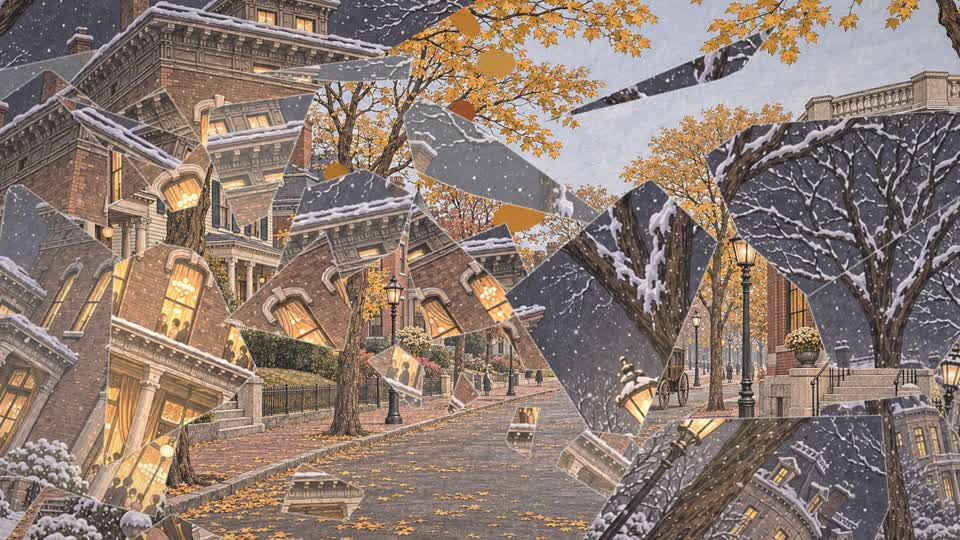
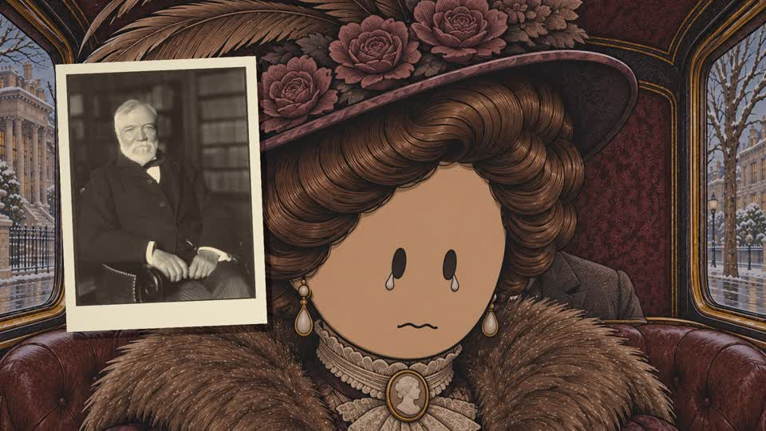

# yt-film

**A Claude Code skill and a Python film engine that turn ~150 still images and a narration into a finished,
living YouTube documentary.** Point Claude at this repo, let it install the engine, and make films where every
picture breathes: chimney smoke, breath in the cold, flickering lamps and the light they throw, snow and rain,
objects lifted out of the painting, drawings inking themselves in, typewriter labels, acting faces, comic pages, a
living map, footnote cards, rubber stamps, rolling counters, tears and shatters, all timed to the narrator's words,
with synthesised sound, a ducked score and YouTube-ready loudness.

No After Effects, no AI video, no stock footage, no render farm. It runs on a Mac or a Windows PC.

<p align="center">
  
  
  <br>
  
  
  
</p>

▶ **See it move: [`examples/chadwick/video/chadwick_effects_test.mp4`](examples/chadwick/video/chadwick_effects_test.mp4)**
(70 seconds, every technique on the example's real images: smoke, breath, flames and light, snow, the note slipping
from a muff and landing, handwriting on the note, an acting face, a drawing made live, the con explained as drawings
on a card, a rolling money counter, a glass-shatter transition, a crowd, a stamp, the note torn in two, a footnote).

---

## Contents
1. [What you need](#what-you-need)
2. [Install (Mac and Windows)](#install)
3. [From title to final film: the whole process](#from-title-to-final-film)
4. [Images with any tool](#images-with-any-tool)
5. [Voice: Gemini TTS or your own](#voice)
6. [Music, dubs, thumbnails, the ending](#music-dubs-thumbnails-the-ending)
7. [Slow PCs](#slow-pcs)
8. [The Chadwick example](#the-chadwick-example)
9. [Repo map](#repo-map)
10. [Troubleshooting](#troubleshooting)

---

## What you need

| | Required | Notes |
|---|---|---|
| **Claude Code** (CLI or desktop app) | yes | Claude reads the skill and runs everything |
| A Mac (Apple Silicon or Intel) or a Windows 10/11 PC | yes | Linux works too; 8 GB RAM minimum, 16 GB+ comfortable, ~10 GB free disk per film |
| Python 3.11 + FFmpeg | yes | installed by the setup script |
| An image tool | yes | ChatGPT, Codex, Google Flow/Whisk/Gemini, the Gemini API, Midjourney, Leonardo, Ideogram, Firefly, local SDXL/Flux... |
| A Gemini API key | recommended | free tier is enough to start: narration (TTS), music (Lyria), crowd murmur, dubs, optional images. [Get one](https://aistudio.google.com/apikey). Without it: bring your own voice and music |

## Install

**The easy way:** open Claude Code and say:

> Install the yt-film skill from https://github.com/AGBOOLA-JOEL/yt-film and set it up on this computer.

Claude clones it into `~/.claude/skills/yt-film`, runs the right setup script, checks everything with the doctor
and fixes what's missing. (It's a private repo: run `gh auth login` first, or be added as a collaborator.)

**By hand, macOS** (needs [Homebrew](https://brew.sh)):
```bash
git clone https://github.com/AGBOOLA-JOEL/yt-film.git ~/.claude/skills/yt-film
cd ~/.claude/skills/yt-film && bash setup/install_mac.sh
```

**By hand, Windows** (PowerShell):
```powershell
git clone https://github.com/AGBOOLA-JOEL/yt-film.git "$env:USERPROFILE\.claude\skills\yt-film"
cd "$env:USERPROFILE\.claude\skills\yt-film"; powershell -ExecutionPolicy Bypass -File setup\install_windows.ps1
```

The setup installs Python 3.11 and FFmpeg if missing, creates `.venv` with the engine's libraries and Whisper
(mlx-whisper on Apple Silicon, faster-whisper elsewhere), downloads free fonts on Windows, turns on UTF-8 for Python
on Windows, makes your `.env`, and runs `scripts/doctor.py`. Then add your key and channel name to `.env`:
```
GEMINI_API_KEY=...
YTF_CHANNEL=Your Channel
```
Restart Claude Code; *"what skills do you have?"* should list **yt-film**.
Details, Windows notes (Defender, OneDrive, long paths, new terminal after installs) and updating:
[`references/install.md`](references/install.md).

## From title to final film

You talk to Claude; Claude runs the engine. Here is the whole road, with what you do and what Claude does.

| # | Step | You | Claude | Result |
|---|---|---|---|---|
| 0 | **Idea** | "Find me 5 story ideas about early aviation" or bring your own title | researches candidates, checks YouTube for the gap, pitches with a recommendation | a story and a hook type |
| 1 | **Project** | | `scripts/new_project.py <story>` | `~/yt-film-projects/<story>/` with the engine in `tools/` |
| 2 | **Facts** | answer questions, approve | researches, writes `OUTLINE.md`: every fact with its source, weak ones flagged | a fact list the script must obey |
| 3 | **Image guide** | say which image tool you use and the art style | writes `IMAGE_GUIDE.md`: the story beat by beat as ~150 shots (wide, medium, face, detail, point of view), the style opener, character blocks, sketch sheets, blank "bases", exact filenames | your storyboard |
| 4 | **Images** | generate them in order (style card → cast → scenes → line versions → sheets → bases) and save them with the guide's names (or let `sort_images.py` name your downloads) | checks each group: hands, faces, era, text, framing; lists redos; writes a resume guide if a chat gets stuck | `incoming/` full |
| 5 | **Script** | read, comment | writes `SCRIPT.md` **from the images**: one passage per beat, every image placed, facts checked against the outline, your end line | the narration |
| 6 | **Voice** | listen to the 30-second test; or record/generate your own and hand Claude the file | Gemini TTS (slow read → 1.25x, pauses capped, pace evened out) or `import_voice.py`; Whisper times every word | `voice/bN_vo.wav` + word timings |
| 7 | **Music** | approve the cues, or drop in your own tracks | writes Lyria prompts per section, generates them, maps them to batches | `audio/music/` |
| 8 | **Shots** | look at the stills sheets | per batch: gridded image sheets → the living layers of every picture → a shot list cued on the words → `stills.py` contact sheet + readability check → fixes | `tools/shots_bN.py` |
| 9 | **Renders** | say "render" | `render_all.py`: all batches in parallel, as many as your machine can take, at low priority | `renders/bN.mp4` |
| 10 | **Ending** | describe your sign-off (once per channel) | adapts `cta.py` (example: your name handwritten, like/subscribe/bell drawn and clicked) | `renders/cta.mp4` |
| 11 | **Final film** | say "make the final" | `final.py`: joins everything, one continuous score ducked under the voice, −14 LUFS; checks length, fps, loudness, stills | `renders/<story>_final.mp4` |
| 12 | **Dubs** (optional) | pick languages | `dub.py` (Spanish + French by default, more languages on request): translated, re-voiced, fitted to the original timing, same mix | `dubs/out/<story>_<lang>.m4a` for YouTube's multi-language audio |
| 13 | **Thumbnails** | generate from the guide, pick one | writes a thumbnail guide with four variants and title ideas | `thumbnails/` |

Claude never starts a render on its own: checking is done with stills sheets (~30 s a batch); rendering waits for
your go-ahead. A typical film: images 3–5 hours of your time (manual) or minutes (API); everything else is mostly
Claude's work across a few sessions.

## Images with any tool

The engine needs files, not a particular tool. Full guide: [`references/image-generation.md`](references/image-generation.md).

- **ChatGPT**: one chat for the whole film, the opener pasted once, the style card and cast sheets attached to every
  prompt; face close-ups as EDITs of the shot before.
- **Codex / an agent**: give it the guide and the full `incoming/` path; it saves files with the right names.
- **Google Flow / Whisk / Gemini app**: style card and cast sheets as ingredients/references on every shot; 16:9.
- **Gemini API, automatic**: Claude writes `IMAGE_PROMPTS.jsonl`; `python tools/imagegen.py` makes every image with
  its references attached and saves it under its exact name.
- **Midjourney, Leonardo, Ideogram, Firefly, Krea, local models**: style + character references, 16:9, low stylize.

**Naming downloads automatically:** generate in the guide's order, let the downloads pile up, then
```bash
python scripts/sort_images.py ~/Downloads ~/yt-film-projects/my_story --group 02_scenes --since 2h
```
It names them in order, converts to PNG and writes a labelled contact sheet so you can check every name.

**Consistency** (one style card, cast sheets attached every time, EDITs instead of re-prompts, one chat per film,
check by groups): [`references/consistency.md`](references/consistency.md).

**Art style**: the example uses egg-headed people in an era-accurate world, ink line and matte pastel gouache.
That's only a suggestion: watercolour, linocut, comic, chalk pastel, noir ink, children's-book, travel-poster...
anything flat and sharp works. What the engine needs from a style: [`references/art-styles.md`](references/art-styles.md).

## Voice

**Gemini TTS** (default): the narrator voice reads slowly with a documentary style prompt, then is sped to 1.25x,
pauses capped, pace checked per passage (`voice.py --pace`). Other voices with `YTF_VOICE`.

**Your own voice or another TTS** (ElevenLabs, OpenAI, Azure, CapCut, your microphone): write the script with
Claude, record or generate it, then hand it over in whichever shape you have:
```bash
python tools/import_voice.py --full narration.mp3        # one file for the whole film: matched to the script and cut into batches
python tools/import_voice.py --passages takes/           # P01.mp3, P02.mp3 ... one per passage (easy to redo one)
python tools/import_voice.py --batches my_batches/       # b1.wav, b2.wav ...
```
Whisper times every word either way (mlx-whisper on Apple Silicon, faster-whisper on Windows/Intel). Full guide:
[`references/voice.md`](references/voice.md).

## Music, dubs, thumbnails, the ending

- **Music**: Lyria cues per section from `music.py`, or your own licensed tracks in `audio/music/`. The score sits
  −25 dB under the voice and dips −9 dB more while the narrator talks. [`references/music.md`](references/music.md)
- **Dubs**: `dub.py` makes complete Spanish and French audio tracks (other languages on request) for YouTube's multi-language
  audio, fitted to the film's timing. [`references/dubs.md`](references/dubs.md)
- **Thumbnails**: one big expressive face, movie-poster light, a graphic device, 2–3 huge words; a guide and four
  variants per film. [`references/thumbnails.md`](references/thumbnails.md)
- **The ending**: make your own animated sign-off once. `cta.py` is a working Python example (your channel name
  handwritten on a sketchbook page, a thumbs-up, subscribe button and bell drawn in ink and clicked); change it into
  anything. [`references/cta.md`](references/cta.md)
- **Final render and checks**: [`references/final-render.md`](references/final-render.md)

## Slow PCs

`render_all.py` sizes itself to your machine (about one batch per 2 cores and 3 GB RAM) and renders at low priority.
On a slow laptop: check with stills sheets, preview only what you're unsure of, render full batches once overnight
with `--changed`, and set in `.env`:
```
YTF_JOBS=1
YTF_X264_PRESET=faster
YTF_WHISPER_MODEL=small.en
```
Windows: exclude the projects folder from Defender scanning, keep projects out of OneDrive, plug in and use Best
performance. More: [`references/performance.md`](references/performance.md).

## The Chadwick example

`examples/chadwick/` is a complete film, *Carnegie's Daughter*: Cassie Chadwick, the Ontario farm girl who borrowed
millions from Ohio bankers as Andrew Carnegie's "secret daughter" (12 minutes, 9 batches). Everything that made it
is here: the fact outline, the 164-image guide, every image, the script, the narration with word timings, the Lyria
cues, the shot lists, the effects test, the archive photos with credits, and a 1904 research pamphlet. Load it as a
project and look at any batch without rendering:
```bash
.venv/bin/python scripts/new_project.py chadwick --example chadwick
cd ~/yt-film-projects/chadwick/tools && ~/.claude/skills/yt-film/.venv/bin/python stills.py b1
```
Read its shot lists next to its stills to learn the engine; ask Claude to explain any shot. See
[`examples/chadwick/README.md`](examples/chadwick/README.md).

## Repo map

```
SKILL.md                 what Claude follows (the whole method)
README.md                this page
.env.example             every setting, with comments
setup/                   install_mac.sh, install_windows.ps1
scripts/                 new_project.py, doctor.py, sort_images.py, image_contact.py, video_stills.py
engine/                  the film engine (copied into each project's tools/)
  film.py                frames, camera, marks, sound, the render loop, the readability check
  seq.py                 the shot sequencer and builders: scene, drawin, page, map_shot, custom
  fx2.py                 living layers: Smoke, Breath, Flame, Light, Lift, Draw, Tear, Counter, the map
  signature.py, wr.py    faces that act, comic pages, stamps, tags, photos, footnotes, rays, haze
  kit.py, sketch.py, stages.py   labels, pages, maps, pen strokes, drawing order
  voice.py, import_voice.py      narration (Gemini TTS / your own audio) + word timings
  music.py, walla.py     score and crowd murmur (Gemini)
  render_all.py          parallel renders sized to the machine
  final.py, cta.py, dub.py       final join, the example ending, dubbed tracks
  imagegen.py            optional automatic images (Gemini API)
  ytf.py                 portable paths, fonts, settings, Whisper (Mac/Windows/Linux)
  geo/                   Natural Earth land, borders, lakes (public domain)
assets/footnote/         the footnote hand, note and board (replace with your own art if you like)
fonts/                   free fonts downloaded by the setup (Windows/Linux)
references/              the guides (install, images, consistency, styles, voice, music, dubs, thumbnails,
                         ending, engine API, rendering, performance, troubleshooting, story finding, hooks)
examples/chadwick/       the complete example film and its effects test video
```

## Troubleshooting

`python scripts/doctor.py` checks everything. Common fixes (ffmpeg not found, Unicode errors on Windows, missing
images, cues Whisper misheard, memory, rate limits): [`references/troubleshooting.md`](references/troubleshooting.md).

---

Real archive photos in the example are public domain (Wikimedia Commons / Library of Congress, credited in
`examples/chadwick/incoming/05_photos/CREDITS.md`). Fonts downloaded by the setup are under the SIL Open Font Licence
or Apache 2.0. Natural Earth data is public domain. Private repository: all other content © the owner, not for
redistribution.
